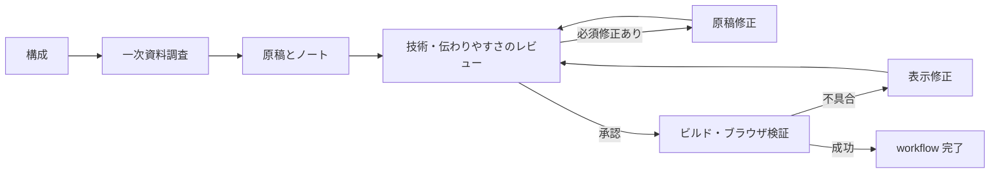

# 勉強会スライドの制作

`slide-production` は、このリポジトリの Pandoc・Astro・reveal.js 構成向けの TAKT ワークフローです。TAKT 0.73.0 で定義を検証しています。リポジトリ内の定義とファセットを利用するため、ホーム配下の動画用ワークフローは不要です。

## 制作の流れ



入力・根拠・必須の検証環境が不足すれば理由を報告して停止します。ループを含めて最大32工程です。レビューは技術的な正確さと伝わりやすさの2観点を並行して行います。表示修正後も内容レビューと検証をやり直します。

## 準備

1. [依頼の雛形](templates/slide-order.md)をコピーし、必須欄を埋める。テーマ、聴衆と前提知識、発表時間、到達目標、slug が必要です。slug は英小文字・数字・ハイフン（例: `nix-intro`）にし、既存原稿と重複させません。
2. 参考資料と、自分の経験として話したい内容を揃える。発表者名や所属、発表日を省略した場合は創作しません。資料を参照できない環境では、本文や必要部分を入力資料として渡します。
3. マージ済みの最新 main を開始点にした、独立した作業ブランチ・worktree を利用する。TAKT が作る作業先にこの `.takt/` の定義と入力資料が含まれることを確認します。
4. Node.js・npm・Pandoc、およびブラウザを操作できるエージェント環境を用意する。プロバイダー・モデル・権限は利用中の TAKT 設定を引き継ぎます。Web 調査の可否もその環境に依存します。

## 実行

開発先 `lt-slide-warehouse` のルートで起動します。

```sh
# エージェントを起動せずに定義を検査
takt workflow doctor slide-production

# 対話で記入済みの依頼を渡し、内容を確認して /go
takt --workflow slide-production --auto-pr --draft
```

`--auto-pr --draft` は workflow 成功後のランナーに commit・push・Draft PR 作成を依頼します。GitHub の認証と push 権限を事前に確認してください。workflow の各担当者は commit・push・PR 作成を行いません。自動マージや公開も行いません。

キューを使う場合は、登録時の workflow を `slide-production`、base branch を最新の `main` にし、worktree と Draft PR・push の設定を確認します。添付は task directory の `attachments/` 配下に置き、登録後に保存された指示・添付・開始ブランチを読み返します。必要情報の返答待ちになる依頼は先に埋めてから登録してください。

## 成果物

| 保存先 | 内容 |
| --- | --- |
| `src/slides/<slug>.md` | 公開対象のスライド原稿 |
| `docs/slides/<slug>/brief.md` | 発表条件・到達目標・資料の参照元 |
| `docs/slides/<slug>/outline.md` | 構成、各スライドの要点と推定時間 |
| `docs/slides/<slug>/research.md` | 主張と一次資料・確認日・未確認事項 |
| `docs/slides/<slug>/speaker-notes.md` | 見出しに対応する話す内容・デモ手順 |
| `docs/slides/<slug>/revision-log.md` | 修正が発生した場合の指摘と対応 |
| `docs/slides/<slug>/verification.md` | ビルド・表示・操作の実行結果 |

`docs/` のメモも PR に含まれ、GitHub リポジトリから閲覧できます。原稿・ノート・添付から転記する内容に非公開情報を含めないでください。レビューの工程レポートは TAKT の実行レポートとして保存されます。

生成先の `src/content/slides/` は編集・コミットしません。`--slide-level 2` の H1/H2 構成を使い、調査メモや発表者ノートを `src/slides/` に置かないでください。

## 完了の判定

- 企画と出典に照らした2観点のレビューで、必須修正が残っていない。
- `npm ci` と `npm run build` に成功している。原稿追加だけのために新しい自動テストは作らない。
- ブラウザで一覧と対象スライドを開き、1280x720 と依頼された追加サイズで全スライドの可読性・画像・コードの表示、スライド送り・戻りを確認している。H2 がある場合は縦方向も確認する。
- 検証したブラウザ、画面サイズ、URL、コマンドと終了コードを `verification.md` に記録している。

ビルドだけ成功した場合やブラウザを起動できない場合は、表示検証を省略して完了にはしません。環境不足は BLOCKED、不具合は修正工程へ進みます。共有テンプレート・アプリ・依存関係の変更が必要な場合は別の変更として扱います。

## 定義の確認・改修

```sh
takt workflow doctor slide-production
takt workflow inspect slide-production
```

ワークフローは [定義ファイル](../.takt/workflows/slide-production.yaml)、共通の約束は [policy](../.takt/facets/policies/slide-production.md)、既存構成と検証方法は [knowledge](../.takt/facets/knowledge/slide-repository.md) にあります。プロジェクト内の明示した参照先を使い、ホーム配下の同名ファセットに依存しません。

定義検査と inspect はエージェントを起動しません。TAKT 0.73.0 の `takt prompt slide-production` は判定プレビューで `reportContent is required for report-based judgment` により停止するため、この版では利用手順に含めていません。

定義検査だけでは実制作の品質や外部ツールの利用可否は確認できません。記入済みの依頼で実行して確認してください。
